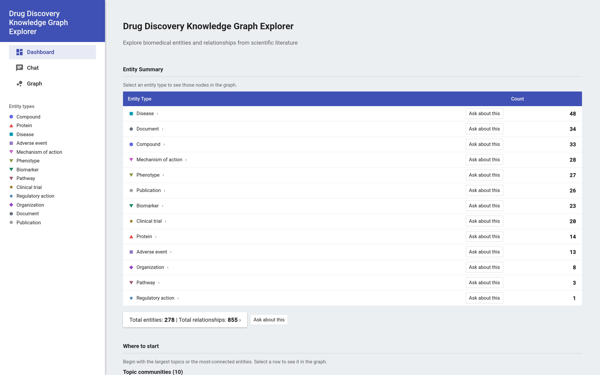
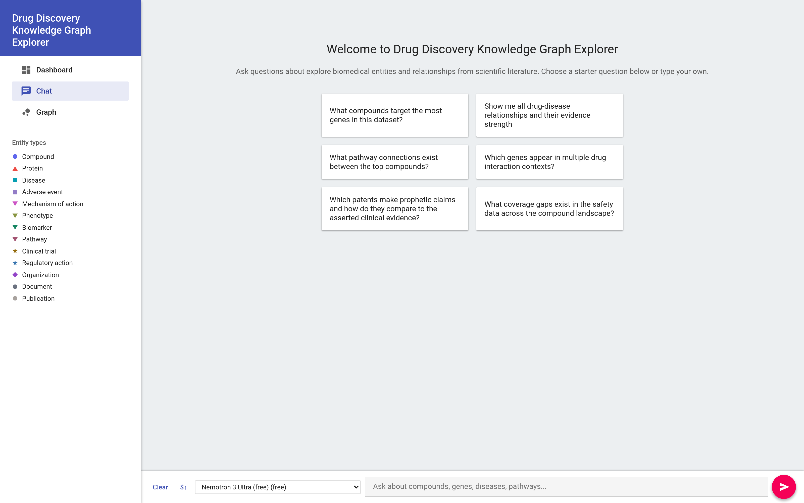
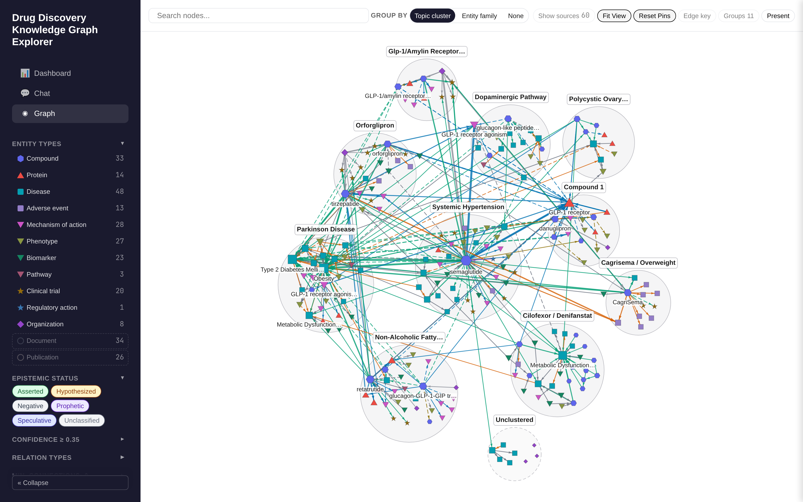
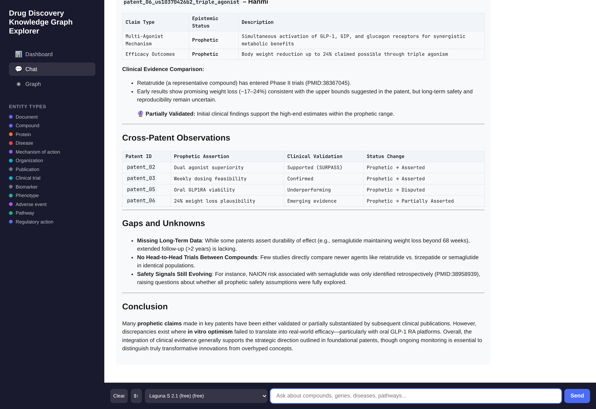

# Interactive Workbench

The static `graph.html` written by `/epistract:view` shares the workbench's graph panel renderer (a single offline file, graph only). On top of it, epistract ships an interactive FastAPI-backed workbench with three panels: a force-directed graph canvas, a chat assistant powered by Claude, and an auto-generated dashboard summary.

Launch it with:

```
/epistract:dashboard <output_dir> --domain <name>
```

The workbench opens at `http://127.0.0.1:8000`.

## Install

Epistract runs as a [Claude Code](https://claude.ai/claude-code) plugin. Two-step install:

### Prerequisites

- **[Claude Code](https://claude.ai/claude-code)** — the CLI/IDE host for the plugin
- **Python 3.11, 3.12, or 3.13** — `scripts/setup.sh` enforces `>= 3.11` and warns on 3.14+. Tested primarily on 3.13.
- **[uv](https://docs.astral.sh/uv/)** — required. Handles the project `.venv`, dependency resolution, and lockfile. Install with `curl -LsSf https://astral.sh/uv/install.sh | sh`.

Optional (enabled automatically when detected):
- **RDKit** — molecular validation for drug-discovery SMILES / InChIKeys
- **Biopython** — sequence validation for DNA / RNA / protein sequences
- **Azure AI Foundry, Anthropic, or OpenRouter API key, or a local OpenAI-compatible server** — only needed for the chat panel and the epistemic narrator. Graph, extraction, and rule-based epistemic analysis all work without an LLM key.

### Step 1 — Install the plugin in Claude Code

```
/plugin marketplace add usathyan/epistract
/plugin install epistract
```

You should see `epistract` (version 3.0.0) in the installed list, and the `/epistract:*` commands should autocomplete in your Claude Code prompt (`setup`, `ingest`, `build`, `view`, `validate`, `epistemic`, `query`, `export`, `domain`, `dashboard`, `ask`, `acquire`).

### Step 2 — Install Python dependencies

```
/epistract:setup
```

This runs `scripts/setup.sh` which creates `.venv/`, installs `sift-kg`, `chonkie`, and the `workbench` extra from `pyproject.toml` (`fastapi`, `uvicorn`, `sse-starlette`, `httpx`, `pyyaml`, `rich`), and checks for RDKit / Biopython. Re-run this whenever you upgrade the plugin.

To install just the workbench dependencies into an existing venv:

```bash
uv pip install -r pyproject.toml --extra workbench
```

## Panels

### Dashboard — auto-generated summary



Auto-generated entity summary for the loaded graph — entity types with deduplicated counts and totals; select a type to see those nodes in the graph. Below it, **Where to start** lists the topic communities (with member counts and top members) and the 10 most-connected entities; selecting one opens the graph zoomed to that community or focused on that entity. Further down are epistemic health cards, the documents table and analysis findings. Every card has an **Ask about this** button that opens Chat with a ready-made question (for example *"Summarize the Systemic Hypertension community."*) in the input box; nothing is sent until you press Send. Domains can ship a custom `dashboard.html` under `domains/<name>/workbench/` for richer layouts; otherwise `/api/dashboard` builds the summary from `graph_data.json`.

### Chat — domain-aware analyst



The chat panel reads its title, body text, placeholder, starter questions, and system-prompt **persona** from `domains/<name>/workbench/template.yaml`. Switch domains and the entire chat persona changes — the same workbench code works for any domain. The input bar has a Clear button to reset the conversation and a model picker (with a cost-sort toggle) for choosing which model answers.

### Graph — visual exploration



Full knowledge graph rendered in the workbench: nodes colored and shaped per entity type from the domain's `domain.yaml` `display` hints, with source documents hidden until "Show sources" is pressed, hover cards on nodes and edges, an edge key with one color per relation category, "Group by" (Topic cluster by default, Entity family, or None), focus mode (double-click a node, or use the sidebar button, to see its 1- or 2-hop neighborhood; Esc exits), and a search bar for direct entity lookup. Above the graph sit entity-type and epistemic-status filter pills, a confidence threshold slider, a relation-type filter, a minimum-connections slider, and Fit View / Reset Pins / Present buttons (Present, or the P key, enlarges labels, nodes and lines for projectors and collapses the sidebar). Pan, zoom, click any node to see neighborhood context; toggle entity types and the other filters to isolate sub-graphs.

### Chat — epistemic layer in action



Ask *"Which patents make prophetic claims and how do they compare to the asserted clinical evidence?"* and the chat panel surfaces the prophetic claims the epistemic layer identified. With the drug-discovery persona active, the selected model (whichever is chosen in the input bar's model picker) produces a structured analysis: per-patent prophetic claims, status flags, a comparison against the asserted clinical evidence, and a meta-analysis highlighting the biggest gaps between prophetic claims and commercial reality. This is the cross-document synthesis the workbench is designed for.

## What You Can Do

- **Ask natural-language questions** — *"What are the resistance mechanisms for sotorasib?"*, *"Compare semaglutide vs tirzepatide adverse events"*. Answers stream back via SSE with citations to source documents.
- **Explore the graph visually** — pan, zoom, filter by entity type, search by name, click any node for neighborhood context.
- **Drill to source** — every answer links to the documents, entities, and relations that support it (sources panel).
- **Review the epistemic layer** — contradictions, hypotheses, prophetic claims, and the full analyst narrative surface in chat answers when `/epistract:epistemic` has been run.

## Configuration

Workbench appearance and persona are domain-configurable via `domains/<name>/workbench/template.yaml` — title, subtitle, entity colors, persona prompt, starter questions, placeholder, loading message, and `analysis_patterns`. The same workbench code works for any domain.

The `persona` field serves **both** surfaces: the workbench chat uses it as its system prompt (reactive — fires on user questions), and `/epistract:epistemic` feeds the same persona to the LLM narrator that writes `epistemic_narrative.md` (proactive — fires after the graph is built). Upgrade the persona once; both surfaces improve together. A strong persona names a profession, describes depth of expertise, and commits to the epistemic-status vocabulary (`asserted` / `prophetic` / `hypothesized` / `contested` / `contradictions` / `negative`) — see `domains/drug-discovery/workbench/template.yaml` for a reference implementation.

## LLM Provider

The chat panel and the epistemic narrator share credential-resolution logic. Priority:

0. **`EPISTRACT_LLM_PROVIDER`** — `local`, `anthropic`, `openrouter` or `foundry`. An explicit choice that **fails loud** (an error naming the missing variables) when that provider's credentials are missing, instead of falling through to another one.
1. **Local server** — `EPISTRACT_LLM_BASE_URL` (llama.cpp, Ollama, vLLM, LM Studio). No API key needed. See [Local server](#local-openai-compatible-server).
2. **Azure AI Foundry** — `AZURE_FOUNDRY_API_KEY` (or alias `ANTHROPIC_FOUNDRY_API_KEY`) plus **one** endpoint selector:
   - `AZURE_FOUNDRY_BASE_URL` (or alias `ANTHROPIC_FOUNDRY_BASE_URL`) — full custom gateway URL for enterprise deployments behind API management, private endpoints, or reverse proxies. `/v1/messages` is auto-appended if missing.
   - `AZURE_FOUNDRY_RESOURCE` — standard Azure resource name. The workbench builds `https://<resource>.services.ai.azure.com/anthropic/v1/messages`.
   - Optional: `AZURE_FOUNDRY_DEPLOYMENT` (or alias `ANTHROPIC_FOUNDRY_DEPLOYMENT`) — deployment/model name, defaults to `claude-sonnet-4-6`.
   - **Fails loud** if the API key is set but neither `AZURE_FOUNDRY_BASE_URL` nor `AZURE_FOUNDRY_RESOURCE` is configured.
3. **`ANTHROPIC_API_KEY`** → calls Anthropic directly with `claude-sonnet-5`.
4. **`OPENROUTER_API_KEY`** → calls OpenRouter with `anthropic/claude-sonnet-4.6`.

Set one of these in your shell before launching. The graph, sources, and rule-based epistemic analysis all work without any LLM credentials — only the chat panel and the narrator need them.

Because the local server ranks above the cloud keys, a set `EPISTRACT_LLM_BASE_URL` sends the chat panel and the narrator to it even when cloud keys are also set. Cloud keys are never sent to the local URL. To use a cloud provider anyway, set `EPISTRACT_LLM_PROVIDER` to it.

### Local OpenAI-compatible server

```bash
export EPISTRACT_LLM_BASE_URL="http://localhost:8080"   # host:port, with or without /v1
export EPISTRACT_LLM_MODEL="<model-id>"                 # optional; default: first chat model of /v1/models
export EPISTRACT_LLM_API_KEY="<your-key>"               # optional; sent only when set
export EPISTRACT_LLM_MAX_TOKENS="1024"                  # optional cap on the reply length
export EPISTRACT_LLM_CONTEXT_WINDOW="4096"              # optional; overrides the window read from the server
/epistract:dashboard ./my-graph-output --domain drug-discovery
```

- The model picker lists the server's own `/v1/models` (embedding and rerank models are skipped). The server URL always comes from `EPISTRACT_LLM_BASE_URL`, never from the browser.
- If the server is down when the page loads, the picker shows the configured model with a degraded flag instead of failing.
- With a known context window the reply length is clamped to what is left after the prompt; with an unknown one `max_tokens` is omitted and the server applies its own limit.
- Check the setup first with `python -m core.cli llm check`.
- For what small local models can and cannot do, see [known-limitations.md](known-limitations.md#small-local-models).

### Azure AI Foundry — standard endpoint

```bash
export AZURE_FOUNDRY_API_KEY="your-foundry-api-key"
export AZURE_FOUNDRY_RESOURCE="my-company-ai"                # your Azure resource name
export AZURE_FOUNDRY_DEPLOYMENT="claude-sonnet-4-6"          # optional; this is the default
/epistract:dashboard ./my-graph-output --domain drug-discovery
```

### Azure AI Foundry — custom gateway (enterprise)

When your Foundry endpoint sits behind an API management gateway, VNet-integrated private endpoint, or corporate reverse proxy on a non-standard hostname, set the full URL directly:

```bash
export AZURE_FOUNDRY_API_KEY="your-foundry-api-key"
export AZURE_FOUNDRY_BASE_URL="https://ai-gateway.acme.internal/anthropic"
/epistract:dashboard ./my-graph-output --domain drug-discovery
```

Or using the provider-first naming some enterprise environments prefer:

```bash
export ANTHROPIC_FOUNDRY_API_KEY="your-foundry-api-key"
export ANTHROPIC_FOUNDRY_BASE_URL="https://ai-gateway.acme.internal/anthropic/v1/messages"
```

`AZURE_FOUNDRY_*` and `ANTHROPIC_FOUNDRY_*` are accepted as aliases. `AZURE_FOUNDRY_*` wins if both are set.

### Anthropic / OpenRouter

```bash
export ANTHROPIC_API_KEY="sk-ant-..."
# OR
export OPENROUTER_API_KEY="sk-or-..."
/epistract:dashboard ./my-graph-output --domain drug-discovery
```

## Troubleshooting

- **"No API key found"** in chat or narrator → set one of the env vars above, restart the workbench. For a local server no key is needed: set `EPISTRACT_LLM_BASE_URL`.
- **"Is the server running at ..."** → the local server does not answer at `EPISTRACT_LLM_BASE_URL`. Start it, or check the host and port with `python -m core.cli llm check`.
- **A "daily limit" message** → the provider's daily or quota limit for this key or free model is exhausted; the message names the reset time when the provider gave one. Retrying will not help until then; switch model or provider.
- **Chat goes to the local server although a cloud key is set** → `EPISTRACT_LLM_BASE_URL` wins over cloud keys. Unset it, or set `EPISTRACT_LLM_PROVIDER` to the provider you want.
- **Workbench shows generic persona / default title** → `graph_data.json` has no `metadata.domain`. Rebuild with `/epistract:ingest --domain <name>` to populate the field, or pass `--domain` explicitly to the dashboard command.
- **`ModuleNotFoundError: No module named 'yaml'` (or `uvicorn`, `fastapi`, `sse_starlette`) on launch** → the venv is missing the workbench extra. Run `uv pip install -r pyproject.toml --extra workbench`, or re-run `/epistract:setup`.
- **`/epistract:setup` fails on Python 3.14** → prebuilt wheels may not exist yet. Use 3.13 or 3.12.
- **Port 8000 already in use** → pass `--port 8042` (or any free port) to `/epistract:dashboard`.
